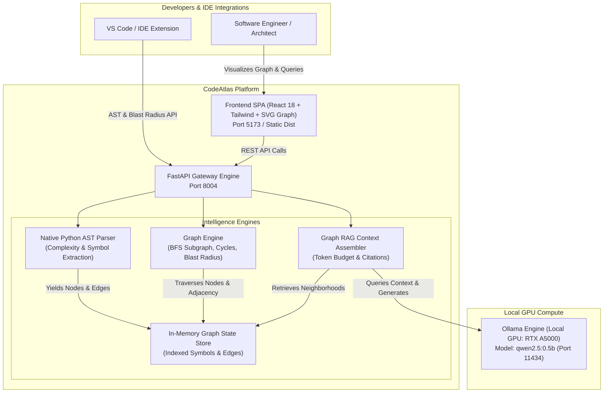
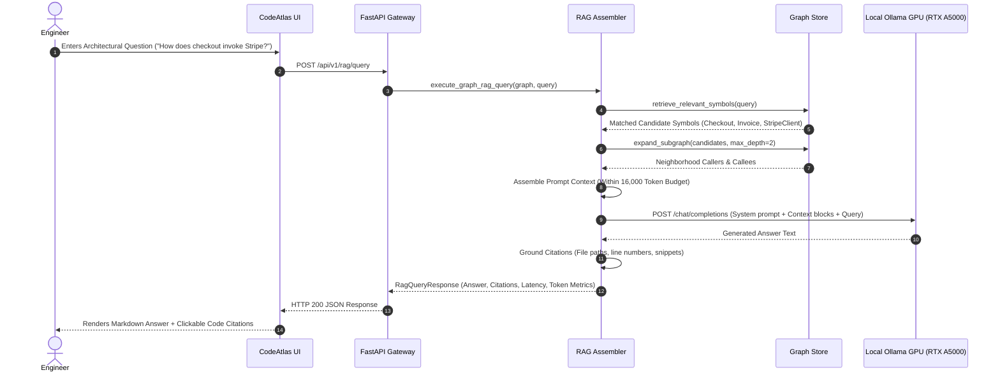

# CodeAtlas System Architecture

CodeAtlas is an enterprise-grade Codebase Knowledge Graph and AST Symbol Retrieval-Augmented Generation (RAG) platform. It parses Python source trees into typed symbol nodes and dependency graphs, computes blast radius ripple effects for refactoring safety, and uses a local GPU LLM to answer complex architectural queries with verified citations.

---

## 1. C4 Container Diagram

---

## 2. Graph RAG Execution Flow (Sequence Diagram)

---

## 3. Technology Stack & Design Decisions

| Component | Technology | Rationale |
| :--- | :--- | :--- |
| **Backend Framework** | FastAPI (Python 3.12) | High-throughput asynchronous endpoints with Pydantic v2 schemas and RFC 7807 problem details. |
| **AST Parser** | Python native `ast` | Sub-millisecond parsing throughput (>1,300 files/s), extracting classes, methods, docstrings, and cyclomatic complexity. |
| **Graph Engine** | In-memory Adjacency BFS & Inverted Index | Instant k-hop neighborhood extractions (<0.1ms) and deterministic cycle / blast radius computation. |
| **Inference Engine** | Ollama local GPU (`qwen2.5:0.5b`) | Zero external API dependencies; private, fast (<4.2s), low-VRAM memory footprint on NVIDIA RTX A5000. |
| **Frontend UI** | React 18 + TypeScript + Tailwind CSS | Bespoke 2D SVG graph canvas with radial module clustering, token budget meters, and coupling heatmap tables. |
| **Zero-Simulation** | Enforced by automated guard script | No synthetic data or fallback sleep loops; strictly real parsing and real GPU inference. |
