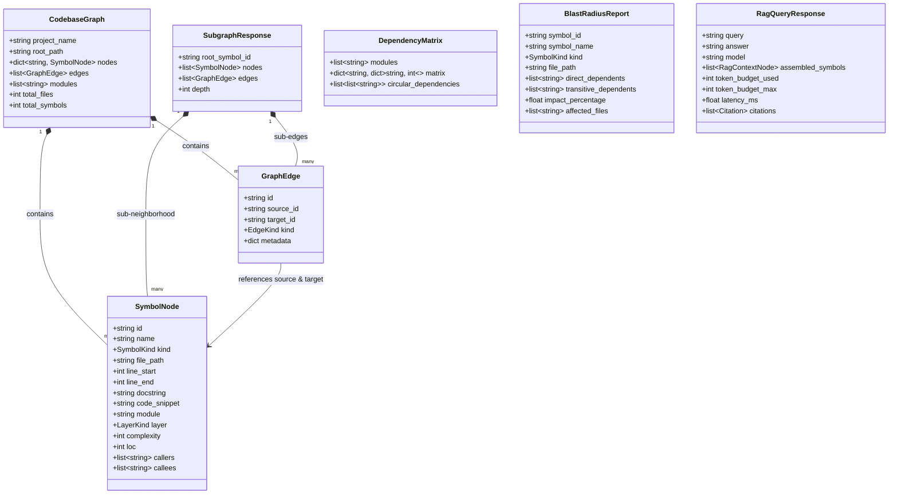

# CodeAtlas Data Model

This document outlines the domain entities, relationships, and data structures utilized by CodeAtlas for codebase knowledge graphs and AST symbol retrieval.

---

## 1. Domain Entity Relationship Diagram

---

## 2. Enums and Classification

### SymbolKind
- `MODULE`: Package directory or top-level module.
- `FILE`: Single source file.
- `CLASS`: Object-oriented class definition.
- `METHOD`: Class method or static/classmethod.
- `FUNCTION`: Standalone module function.
- `INTERFACE`: Abstract Base Class (ABC) or Protocol.
- `TYPE_ALIAS`: Custom type alias or generic definition.

### EdgeKind
- `CALLS`: Direct function invocation or method execution.
- `IMPORTS`: Cross-file import dependency.
- `CONTAINS`: Structural containment (e.g., class contains method).
- `EXTENDS`: Inheritance subclassing.
- `IMPLEMENTS`: Protocol / interface implementation.
- `REFERENCES`: Variable or symbol usage.

### LayerKind
- `API`: REST routers, controllers, ASGI endpoints.
- `DOMAIN`: Core business entities, schemas, models.
- `SERVICE`: Business logic orchestrators and use cases.
- `CORE`: Configuration, security, cryptography, logging.
- `INFRASTRUCTURE`: Database clients, HTTP clients, message queues, caches.
